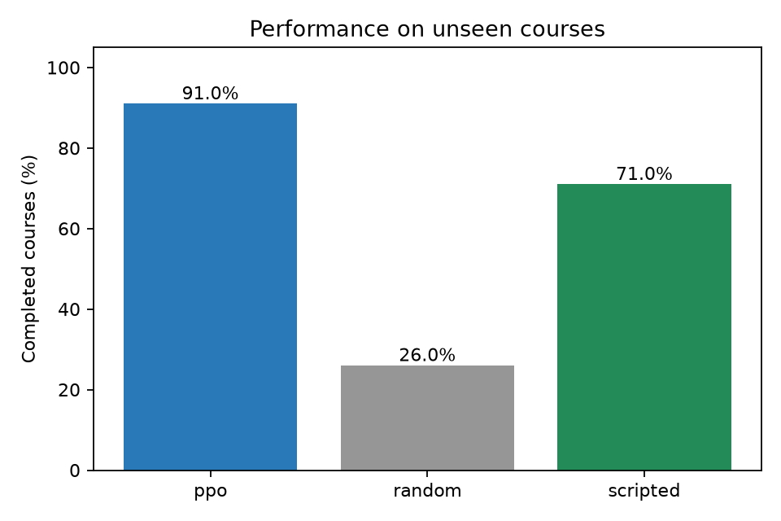

# Evaluation results

Measured on 15 November 2026 using the final PPO checkpoint after a five-million-step run with `gamma=0.995` and training seed 42. No model selection used these 100 courses.

| Policy | Completed | Mean reward | Reward standard deviation | Mean distance |
|---|---:|---:|---:|---:|
| PPO final checkpoint | 91/100 | 78.61 | 18.84 | 1287.51 |
| Random actions | 26/100 | 16.04 | 35.27 | 807.47 |
| Scripted controller | 71/100 | 62.58 | 28.86 | 1228.77 |



[Raw per-episode results](g995-final.json) include exact seeds, rewards, completion, truncation, scores, collisions, and episode lengths. All policies used courses 3,000,000–3,000,099 at full difficulty, three physics steps per action, and a 240-second timeout. No courses in this set failed fairness validation. Random actions use the course seed to initialize the RNG. The scripted baseline uses the existing game's rule-based controller through the same action interface.

PPO improved completion by 65 percentage points over this random baseline and exceeded the scripted controller by 20 percentage points on this set. This is one training seed and one hundred deterministic courses, so repeat the experiment with additional training seeds before claiming a stable average.

Checkpoint SHA-256: `6499ADCA487E4D423ABB05A88E7F5F7B081A83232626A0179A37EA77C2AB8397` (`rl/checkpoints-g995-42/final_model.zip`). Weights remain ignored by Git; reproducing this exact table requires that checkpoint. A fresh training run may differ. The evaluation code and raw data are included for inspection.

```powershell
python -m rl.evaluate_rl --model rl/checkpoints-g995-42/final_model.zip --compare --json rl/results/g995-final.json
python -m rl.plot_results
```

A defensible résumé statement: “Built a PPO agent and Gymnasium environment for procedural terrain navigation, with seeded reproducibility, randomized training courses, checkpoint continuation, TensorBoard monitoring, and baseline evaluation; achieved 91% completion versus 71% for a scripted controller and 26% for random actions across 100 unseen courses in one training run.”
